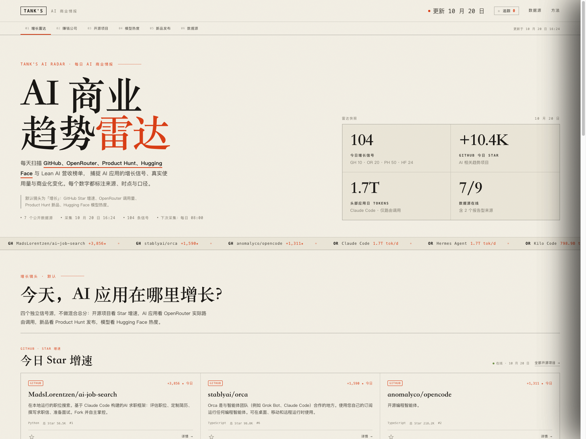
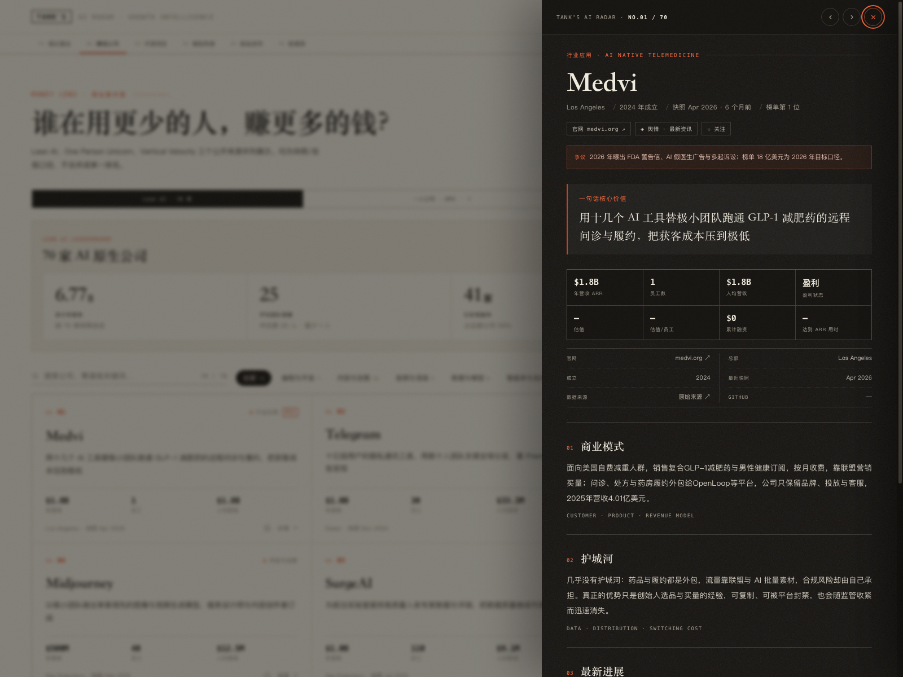

# Tank's AI Radar

**看清 AI 应用的商业趋势，而不是追逐一个混合总分。**

Tank's AI Radar 是一个多源 AI 商业情报看板：每天采集 GitHub、OpenRouter、Product Hunt、Hugging Face 与 Lean AI 营收榜单，用「增长 / 赚钱 / 开源 / 模型 / 新品 / 数据源」六个镜头展示。默认镜头为**增长**。

> **线上地址**：https://tankzzzzzzz.github.io/tanks-ai-radar/
> **代码仓库**：https://github.com/Tankzzzzzzz/tanks-ai-radar
> **Actions**：每日 08:00（Asia/Shanghai）采集 + 部署；周日 20:10 额外执行 Lean 源。

- 在线形态：GitHub Actions 定时采集 → 生成静态站 → GitHub Pages 发布
- 本地形态：`index.html` 单文件，直接双击打开
- 无账号体系：关注列表与追踪数据保存在本机 `localStorage`
- 数据可追溯：每个数字都带来源、时点、方法与置信度




## 六个镜头

| 镜头 | 数据源 | 看什么 |
|---|---|---|
| **01 增长雷达**（默认） | GitHub / OpenRouter / Product Hunt / Hugging Face | 今日 Star 增速、应用调用量、AI 新品、趋势模型 |
| 02 赚钱公司 | Lean AI / One Person Unicorn / Vertical Velocity | 小团队高营收、人均 ARR、ARR / 团队规模 |
| 03 开源项目 | GitHub Trending + Search API | AI 相关开源项目、Star 增速、语言与总 Star |
| 04 模型热度 | Hugging Face | trendingScore、下载、点赞 |
| 05 新品发布 | Product Hunt | AI 分类最新发布（Feed 不含票数） |
| 06 数据源 | 全部源 | 最后成功时间、条目数、接入方式、失败状态 |

> 设计原则：**不做混合总分**。开源热度、API 调用量、消费用户、营收是不同口径，分别展示、分别标注。

## 数据源与更新

| 源 | 更新 | 接入方式 | 置信度 | 备注 |
|---|---|---|---|---|
| GitHub Trending | 每日 | 公共页面解析 + Search API 兜底 | 高 | `stars today` 为 GitHub 页面口径 |
| OpenRouter Rankings | 每日 | 公共 rankings 页面内嵌数据 | 中高 | 仅覆盖 OpenRouter 路由调用，非公司总营收 |
| Product Hunt · AI | 每日 | 公共 Atom Feed | 中 | 不含票数，按发布时间排序 |
| Hugging Face Trending | 每日 | 官方公开 API | 高 | 模型热度信号 |
| Lean AI Leaderboard | 源站每周日 20:00 | 官方公开表格 + Jina 镜像兜底 | 中高 | 营收/人数为快照口径 |
| One Person Unicorn | 随提交 | 公开页面表格 | 中低 | 团队 ≤10 人，ARR 多为自报 |
| Vertical Velocity | 不定期 | 公开页面表格 | 中低 | 垂直 AI 人均 ARR |
| a16z Top 100 Gen AI Apps | 报告型 | 人工结构化导入（待接入） | 高 | 消费级 AI 用户规模/支付 |
| Rank.ai · Companies | 快照型 | 人工结构化导入（待接入） | 中 | 营收/融资/员工，带原始来源 |

采集失败时：保留上一份数据，源状态标记为 `stale`，不会用空数据覆盖看板。

## 目录结构

```text
collectors/
  common.py             # HTTP、表格解析、状态工具
  github_trending.py    # GitHub Trending + Search 兜底
  openrouter_apps.py    # OpenRouter rankings 内嵌数据
  producthunt.py        # Product Hunt Atom Feed
  huggingface.py        # Hugging Face API
  lean_boards.py        # Lean AI / OPU / Vertical Velocity
  run.py                # 采集编排 + status.json
data/
  radar/latest.json     # 最新采集结果
  radar/status.json     # 数据源健康状态
  radar/history/        # 每日快照
  leaderboard_snapshot.csv
  companies.json        # Lean 70 家 + 调研 + 官网/GitHub
  ...
src/
  template.html         # 页面结构 + 基础 CSS
  app.js                # 多镜头、追踪、信号详情、舆情
  extra.css             # 雷达/信号/数据源样式
build.py                # 读取数据 → index.html + dist/index.html
.github/workflows/radar.yml
```

## 本地运行

```bash
# 1) 采集公开源（如本机需要代理，设置 HTTPS_PROXY）
python3 collectors/run.py

# 2) 构建静态站
python3 build.py

# 3) 打开
open index.html
```

说明：
- 采集使用 Python 标准库，无需安装依赖。
- 若本机访问 Google 失败，Lean 采集会自动走 Jina 镜像；也可直接读取已有 `data/leaderboard_snapshot.csv`。
- 只想改前端：修改 `src/` 后运行 `python3 build.py`。

## GitHub Actions + Pages

1. 推送到 GitHub 仓库。
2. Settings → Pages → Source 选择 **GitHub Actions**。
3. 手动运行一次 `Tank's AI Radar · collect & deploy`，或等定时任务。
4. 定时：
   - 每日 08:00（Asia/Shanghai）采集增长类源；
   - 每周日 20:10（Asia/Shanghai）额外执行一次 Lean 源。
5. 工作流会：
   - 采集 → 构建 → 提交 `data/radar/` 与 Lean CSV 快照；
   - 上传 `dist/` 并部署到 Pages。
6. 无需额外 Secret，GitHub API 使用 Actions 自带的 `GITHUB_TOKEN`。

> 若仓库是私有库，Pages 可用性取决于 GitHub 套餐；本地 `index.html` 不受影响。

## 数据口径与限制

- **默认增长镜头不做综合评分**，四个源各自展示；避免把「Star 多」「调用量高」「营收高」混为一谈。
- OpenRouter 数据只代表通过其路由的调用量，不代表公司总营收；Product Hunt Feed 不含票数；GitHub Star 是注意力信号。
- Lean AI / OPU / Vertical Velocity 的营收多为快照或自报口径；详情页会标注快照时间与「N 个月前」。
- a16z 与 Rank.ai 暂为报告型/人工来源，已在「数据源」页列出，下一阶段做结构化导入。
- 无账号体系：关注与追踪数据只保存在当前浏览器；清缓存会丢失，可在追踪面板导出备份。
- GitHub 未登录 API 限流为 60 次/小时；Actions 内使用 `GITHUB_TOKEN` 提高额度。

## 文件

| 文件 | 说明 |
|---|---|
| `index.html` | 构建产物（单文件，内联数据/CSS/JS） |
| `dist/index.html` | 部署产物（同内容） |
| `preview*.png` | 页面预览 |
| `data/radar/latest.json` | 最新雷达数据 |
| `data/radar/status.json` | 数据源健康状态 |
| `data/companies.json` | Lean 公司结构化数据 |
| `build.py` / `src/` | 构建脚本与前端源码 |

## 下一步

1. a16z Top 100 与 Rank.ai 的结构化导入（报告型来源）。
2. 90 天历史与 delta：排名变化、Star 增速、调用量份额变化。
3. 追踪规则：新上榜、排名异动、阈值提醒、每日/每周摘要。
4. 可选：Cloudflare/邮件/Telegram 告警；仍然不做账号体系。

> 生成日期：2026-10-20
